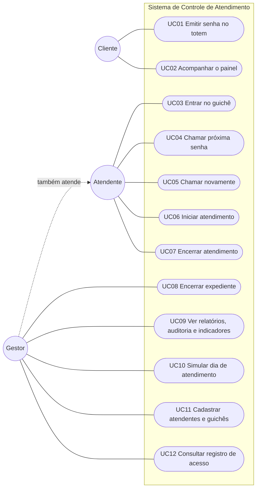

# Requisitos, regras de negócio e casos de uso

Levantados a partir do documento "Sistema para controle de atendimento" (v06, Prof. João Ferreira)
e do edital do projeto final. A coluna **Onde está** aponta o código que atende cada item.

Agentes: **AS** (Agente Sistema, a API), **AA** (Agente Atendente, inclui o gestor) e
**AC** (Agente Cliente, anônimo).

---

## Requisitos funcionais

| Código | Requisito | Quem | Onde está |
|---|---|---|---|
| RF01 | Emitir senha SP, SG ou SE no totem, sem login | AC | `POST /api/v1/senhas` · `senha_service.emitir_senha` |
| RF02 | Mostrar no painel as 5 últimas senhas chamadas (nunca a próxima) | AS | `GET /api/v1/painel` · `painel_service` |
| RF03 | Login do atendente informando o guichê | AA | `POST /api/v1/auth/login` · `auth_service` |
| RF04 | Chamar a próxima senha seguindo a alternância | AA | `POST /api/v1/atendimentos/chamar-proxima` |
| RF05 | Chamar novamente ("última chamada") | AA | `POST /api/v1/atendimentos/chamar-novamente` |
| RF06 | Iniciar o atendimento quando o cliente chega | AA | `POST /api/v1/atendimentos/iniciar` |
| RF07 | Encerrar o atendimento | AA | `POST /api/v1/atendimentos/encerrar` |
| RF08 | Encerrar o expediente, descartando as senhas que sobraram | Gestor | `POST /api/v1/expediente/encerrar` |
| RF09 | Relatório diário e mensal: emitidas e atendidas, no geral e por tipo | Gestor | `GET /api/v1/relatorios/diario` e `/mensal` |
| RF10 | Relatório detalhado por senha (número, tipo, emissão, atendimento, guichê) | Gestor | campo `senhas` do relatório |
| RF11 | Relatório de TM por tipo | Gestor | campo `por_tipo[].tm_minutos` |
| RF12 | Relatório de auditoria (atendente, guichê, senha, 1ª e 2ª chamada, início e fim) | Gestor | campo `auditoria` do relatório |
| RF13 | Indicadores de desempenho (espera, atendimento, não comparecimento, por guichê e atendente) | Gestor | campo `indicadores` do relatório |
| RF14 | Simular um dia de atendimento com o TM sorteado e ~5% de senhas não atendidas | Gestor | `POST /api/v1/simulacao` · `simulacao_service` |
| RF15 | Cadastrar, ativar e desativar atendentes | Gestor | `/api/v1/usuarios` |
| RF16 | Cadastrar, ativar e desativar guichês | Gestor | `/api/v1/guiches` |
| RF17 | Consultar o registro de acesso | Gestor | `GET /api/v1/acessos` |
| RF18 | Áudio da chamada com tipo, sequencial e guichê; "Última chamada" na 2ª vez | Front | API envia `tipo`, `sequencial`, `guiche`, `ultima_chamada` |

## Regras de negócio

| Código | Regra | Onde está |
|---|---|---|
| RN01 | Numeração `YYMMDD-PPSQ`: data, tipo e sequência de 3 dígitos por tipo, reiniciando todo dia | `regras_fila.formatar_numero` · tabela `sequencias_diarias` |
| RN02 | Alternância `[SP] → [SE\|SG] → [SP] → [SE\|SG]`; entre SE e SG, a SE vem primeiro | `regras_fila.ordem_de_busca` |
| RN03 | Fila vazia: o sistema passa para a próxima fila da ordem, sem travar | `regras_fila.ordem_de_busca` (lista de prioridade) |
| RN04 | Qualquer guichê atende qualquer tipo de senha | `atendimento_service.chamar_proxima` |
| RN05 | Expediente das 7h às 17h: fora dele não há emissão nem chamada | `regras_fila.dentro_do_expediente` |
| RN06 | Atendimento em curso pode ser encerrado depois das 17h | `encerrar_atendimento` não verifica horário |
| RN07 | Senhas que sobrarem no fim do expediente são descartadas | `atendimento_service.encerrar_expediente` |
| RN08 | Duas chamadas sem o cliente: a senha vira `NAO_COMPARECEU` e o sistema chama a próxima | `atendimento_service.chamar_proxima` |
| RN09 | A senha só muda de estado pelas transições permitidas (7 estados) | `regras_fila.TRANSICOES_PERMITIDAS` · `senha_service.mudar_estado` |
| RN10 | Duas chamadas simultâneas nunca recebem a mesma senha | lock em `controle_fila` (ADR-03) |
| RN11 | TM simulado: SP 15±5 min, SG 5±3 min, SE 1 min (95%) ou 5 min (5%) | `domain/simulacao.sortear_tm_minutos` |
| RN12 | Cerca de 5% das senhas emitidas não são atendidas | `domain/simulacao.cliente_desiste` |
| RN13 | O painel nunca mostra a próxima senha | `painel_service` lê só senhas já chamadas |
| RN14 | Só o gestor vê relatórios, faz cadastros e encerra o expediente | dependência `somente_gestor` |

## Requisitos não funcionais

| Código | Requisito | Como foi atendido |
|---|---|---|
| RNF01 | Tecnologias do laboratório | Python 3.14 + FastAPI, MySQL 8.0, React 19 |
| RNF02 | API REST documentada | Swagger em `/docs`, rotas versionadas em `/api/v1` |
| RNF03 | Segurança | Senhas com hash bcrypt, login com JWT, perfis, segredos no `.env` (fora do Git), mensagens de login que não revelam se o usuário existe |
| RNF04 | LGPD | Cliente anônimo, minimização de dados, registro de acesso. Ver [`lgpd-e-acessibilidade.md`](lgpd-e-acessibilidade.md) |
| RNF05 | Concorrência | Lock pessimista; teste com 4 atendentes simultâneos (`tests/test_concorrencia.py`) |
| RNF06 | Disponibilidade | `/health`, erro 503 padronizado quando o banco cai, reconexão automática (`pool_pre_ping`), painel mantém as últimas senhas, backup com script |
| RNF07 | Auditoria | Histórico de cada mudança de estado (`historico_estados`) e registro de acesso (`registros_acesso`) |
| RNF08 | Desempenho | Índice `ix_senhas_fila` para a busca da próxima senha; cada chamada leva milissegundos |
| RNF09 | Acessibilidade | Front com fonte para baixa visão, cor sempre com texto, áudio, atalhos de teclado. Ver [`lgpd-e-acessibilidade.md`](lgpd-e-acessibilidade.md) |
| RNF10 | Qualidade | Camadas separadas, erros padronizados, 47 testes automatizados, CI no GitHub Actions |
| RNF11 | Reprodutibilidade | README passo a passo, `.env.example`, `docker compose`, seed com usuários de teste |

---

## Casos de uso

| Caso de uso | Ator | Fluxo principal | Exceções |
|---|---|---|---|
| UC01 Emitir senha | Cliente | Escolhe o tipo no totem; recebe o número e aguarda | Fora do expediente: emissão recusada |
| UC02 Acompanhar o painel | Cliente | Vê as 5 últimas chamadas e ouve o áudio | Sistema fora do ar: painel avisa e mantém as últimas senhas |
| UC03 Entrar no guichê | Atendente | Informa login, senha e guichê | Login ou senha errados; guichê inativo |
| UC04 Chamar próxima | Atendente | O sistema escolhe pela alternância e marca CHAMADA | Fila vazia; senha anterior ainda em atendimento; fora do expediente |
| UC05 Chamar novamente | Atendente | A senha vira CHAMADA_NOVAMENTE e o painel diz "Última chamada" | Guichê livre |
| UC06 Iniciar atendimento | Atendente | Cliente chegou: EM_ATENDIMENTO | Guichê livre |
| UC07 Encerrar atendimento | Atendente | ATENDIDA; o guichê fica livre | Atendimento não iniciado |
| UC08 Encerrar expediente | Gestor | Descarta as senhas que sobraram | Sem permissão (não é gestor) |
| UC09 Ver relatórios | Gestor | Escolhe dia ou mês e vê quantitativos, TM, detalhado, auditoria e indicadores | Sem permissão |
| UC10 Simular dia | Gestor | Escolhe um dia passado e a quantidade de senhas | Dia de hoje ou futuro; dia que já tem senhas |
| UC11 Cadastrar | Gestor | Cria, ativa ou desativa atendentes e guichês | Login ou número de guichê repetido |
| UC12 Registro de acesso | Gestor | Vê quem entrou, gerou relatório ou alterou cadastro | Sem permissão |
